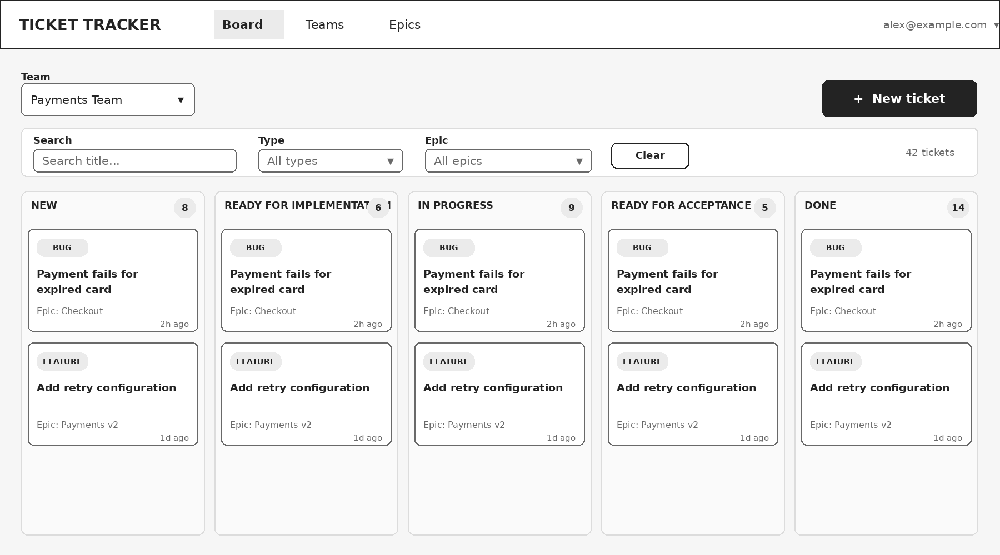
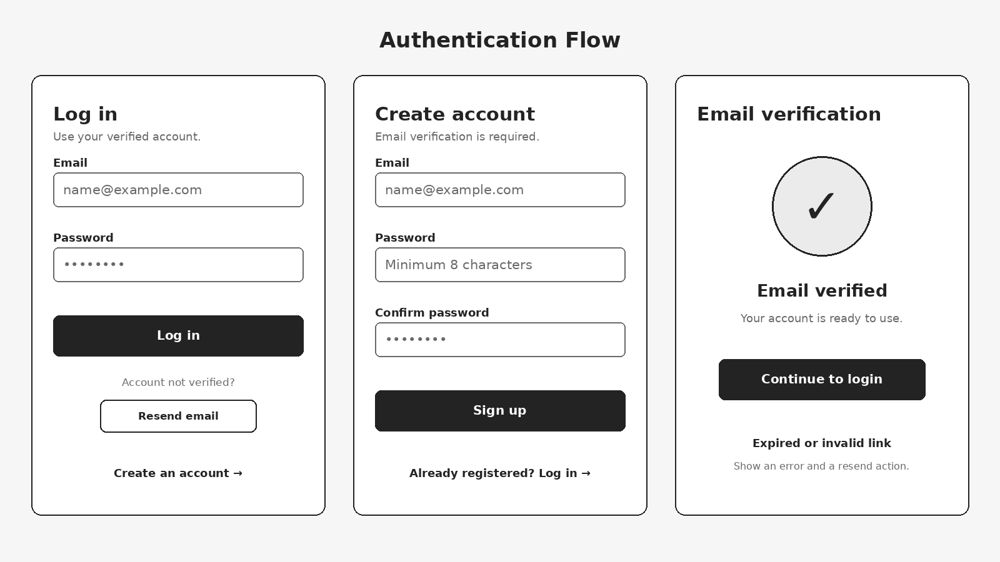
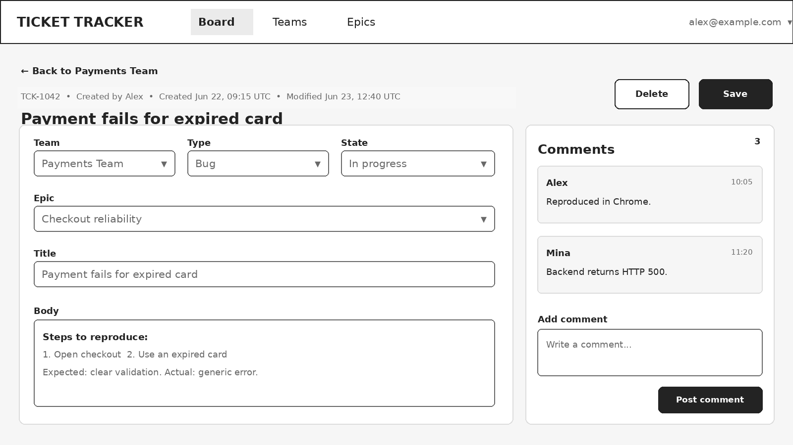
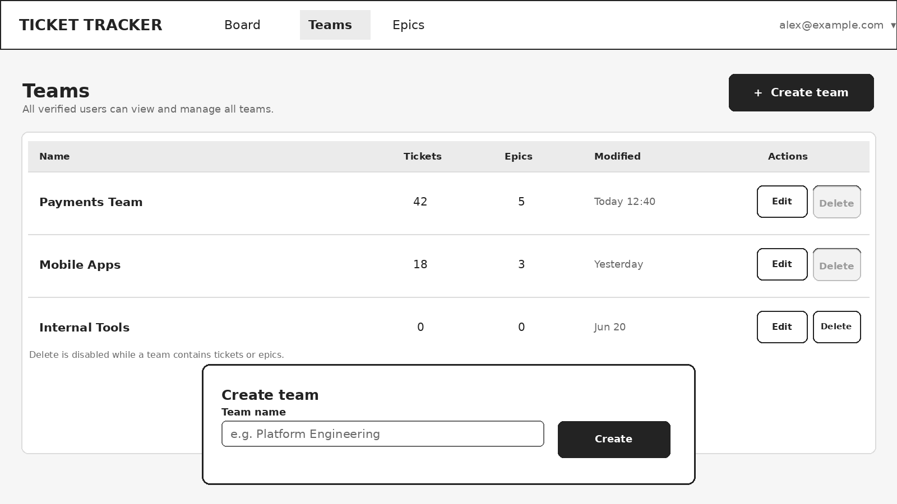
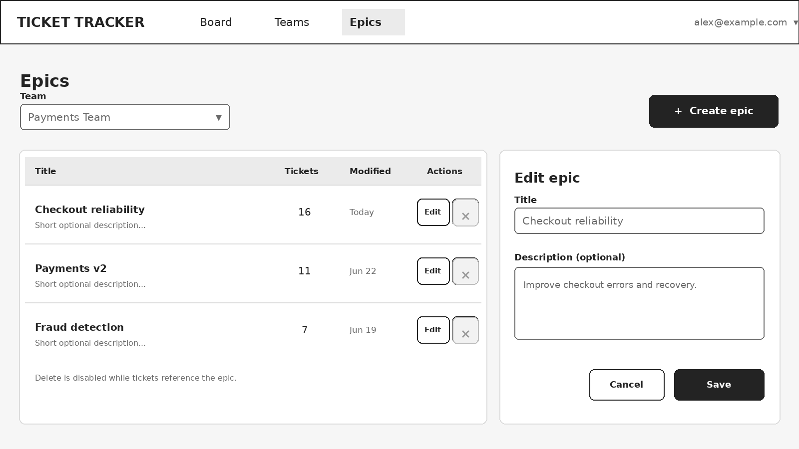

# Ticket Tracker — Project Requirements

> Requirement IDs such as **§3.4** let individual rules be cited in prompts, test cases and bug reports.

Build a small, working Kanban-style ticket tracker as a three-tier SPA backed by an RDBMS.

Mandatory scope: authentication, teams, epics, tickets, comments, and a draggable Kanban board.
Scrum, sprints, SSO, and advanced project-management features are explicitly out of scope.

## 1. Objective

Create a complete web application that allows registered users to organize work tickets by team and move them
through a fixed Kanban workflow. The solution must demonstrate a functional user interface, server-side business
logic, and persistent relational storage.

## 2. Required Architecture

- **§2.1** Single-page application (SPA) frontend.
- **§2.2** Backend application exposing an HTTP API.
- **§2.3** Relational database management system (RDBMS) for all persistent application data.
- **§2.4** Clear separation between presentation, application/API, and persistence tiers.
- **§2.5** The frontend and backend may be deployed as separate containers, or the backend may serve the compiled SPA, provided the three logical tiers remain clearly separated.
- **§2.6** Use a dedicated server-based RDBMS container such as PostgreSQL.
- **§2.7** Programming languages and frameworks are unrestricted. The application must be cross-platform.
- **§2.8** From a clean checkout, the complete solution must start from the repository root with `docker compose up --build`; no host-installed frontend, backend, or database runtime may be required beyond Docker Compose. The QA team must be able to run the application on a clean Windows, macOS, or Linux laptop.

## 3. User Accounts and Authentication

- **§3.1** Users can sign up using an email address and password. Email addresses are trimmed, compared case-insensitively, and must be unique.
- **§3.2** Users can log in and log out using local credentials. SSO and external identity providers are not required.
- **§3.3** Passwords must contain at least 8 characters, must never be stored in plain text, and must be hashed using an established password-hashing algorithm such as Argon2id.
- **§3.4** After sign-up, the system sends an email-verification message through a configurable SMTP service. The implementation must support `relay1.dataart.com`.
- **§3.5** A newly registered account cannot use the main application until the email address is verified.
- **§3.6** Verification links or tokens expire after 24 hours and are single-use. A successful verification leads the user to the login screen; automatic login is not required.
- **§3.7** An unverified user can request a new verification email from the login or verification-result screen. Issuing a new token invalidates earlier unused tokens.
- **§3.8** All business application screens and API endpoints require authentication, except sign-up, login, email verification, and verification-email resend. Static frontend assets and optional health/readiness endpoints may remain public.

## 4. Teams

- **§4.1** Tickets are grouped by team.
- **§4.2** Authenticated users can view the list of teams and create, rename, and delete teams.
- **§4.3** A team has at least: identifier, name, created timestamp, and modified timestamp.
- **§4.4** Team names must be non-empty after trimming and unique case-insensitively.
- **§4.5** A team cannot be deleted while it contains tickets or epics. The UI must show a clear validation message; cascading deletion of a team is not allowed.
- **§4.6** Team ownership and membership are not part of the mandatory scope. All verified users can view and manage all teams.

## 5. Epics

- **§5.1** Each epic belongs to exactly one team.
- **§5.2** The team is selected when the epic is created and cannot be changed later. Moving an epic between teams is out of scope.
- **§5.3** Provide a separate screen for epic CRUD operations: create, list, edit, and delete.
- **§5.4** An epic has at least: identifier, team reference, title, optional description, created timestamp, and modified timestamp.
- **§5.5** Epic titles must be non-empty after trimming.
- **§5.6** A ticket may optionally reference one epic, selected from a drop-down list.
- **§5.7** A ticket may reference only an epic that belongs to the same team as the ticket; the backend must enforce this relationship.
- **§5.8** An epic cannot be deleted while tickets reference it. The UI must show a clear validation message.

## 6. Tickets

**§6.1** Each ticket must contain the following fields:

| Field | Required | Allowed values / type | Notes |
|---|---|---|---|
| ID | Yes | System-generated identifier | Stable and unique. |
| Team | Yes | Reference to a team | Determines the team board. Must reference an existing team. |
| Type | Yes | `bug` \| `feature` \| `fix` | Use exactly these three values. They are classification labels only; no different workflow behavior is required for bug, feature, or fix. |
| State | Yes | `new` \| `ready_for_implementation` \| `in_progress` \| `ready_for_acceptance` \| `done` | These are the canonical API values. The UI should display human-readable labels with spaces. The workflow is fixed; no custom states are required. |
| Epic | No | Reference to an epic | Selected from the epic list for the ticket's team. Must be null or reference an epic from that same team. |
| Title | Yes | Text | Must be non-empty after trimming. It is intended as short display text, but no mandatory application-level maximum length is specified. |
| Body | Yes | Long text | Must be non-empty. Plain text or Markdown is acceptable; rich-text editing is not required. No mandatory application-level maximum length is specified. |
| Created at | Yes | Timestamp | Set by the server in UTC when the ticket is created. |
| Modified at | Yes | Timestamp | Set by the server in UTC whenever ticket fields or state change. Adding a comment does not change it. |
| Created by | Yes | Reference to user | Set automatically from the authenticated user. |

Ticket operations:

- **§6.2** Create a ticket.
- **§6.3** Open and view all ticket fields, including created by, created at, and modified at.
- **§6.4** Edit ticket type, team, epic, title, body, and state.
- **§6.5** The modified timestamp represents the latest actual ticket field or state change. Saving unchanged values must not advance it.
- **§6.6** When a ticket's team changes, the UI must clear or replace any selected epic. The backend must reject a ticket whose epic belongs to a different team.
- **§6.7** Delete a ticket after an explicit confirmation. Deleting a ticket also deletes its comments.
- **§6.8** State changes performed by drag-and-drop must be persisted immediately in the database.
- **§6.9** The backend must validate all submitted enum values and references; client-side validation alone is insufficient.

## 7. Comments

- **§7.1** Authenticated users can add comments to a ticket.
- **§7.2** A comment contains: identifier, ticket reference, author, body, and created timestamp.
- **§7.3** Comment bodies must be non-empty.
- **§7.4** Comments are displayed chronologically, oldest first.
- **§7.5** Adding a comment does not update the ticket modified timestamp and therefore does not change the ticket's board ordering.
- **§7.6** Comments are immutable after creation for the mandatory scope. Editing and deleting comments may be implemented as stretch features.

## 8. Kanban Board

- **§8.1** The primary screen is a Kanban board for one selected team.
- **§8.2** The board contains exactly five columns, one for each ticket state, in workflow order.
- **§8.3** Each ticket is displayed as a card showing at least its title and type. Showing its epic is recommended.
- **§8.4** Users can drag a ticket card from one column to another. Dropping a card changes its state and persists the change through the backend API.
- **§8.5** If a drag-and-drop update fails, the card must return to its previous column and the UI must display an error.
- **§8.6** Cards may be moved directly between any two states; enforcing sequential transitions is not required.
- **§8.7** Within a column, cards are ordered by most recently modified first. Persisting a custom manual order is not required.
- **§8.8** The board must provide a clear way to create a ticket and open an existing ticket.
- **§8.9** At minimum, provide filtering by ticket type and epic, plus a case-insensitive substring search over ticket title. Active filters are combined using AND logic and may be implemented client-side or server-side.
- **§8.10** The interface must remain usable with at least 100 tickets on one team board.

## 9. API and Persistence Expectations

- **§9.1** All create, update, and delete operations must be performed through the backend API and persisted in the RDBMS.
- **§9.2** The application must not rely on browser local storage as the system of record.
- **§9.3** Use database constraints and/or server-side validation to maintain referential integrity.
- **§9.4** Return meaningful HTTP status codes and error messages for validation failures, authentication failures, missing records, and conflicts. Attempts to delete a team that contains tickets or epics, or an epic referenced by tickets, should return HTTP 409 Conflict.
- **§9.5** Identifiers may be UUIDs or database-generated numeric values. API timestamps must use an ISO-8601 representation in UTC.
- **§9.6** Cookie-based sessions or bearer-token authentication are both acceptable. Session identifiers, access tokens, and bearer tokens must not be placed in URLs. A single-use email-verification token may be included in the verification URL.
- **§9.7** Concurrent-edit conflict detection is not required; last successful write wins.
- **§9.8** Database schema creation must be automated through migrations or an equivalent repeatable initialization mechanism.
- **§9.9** After migrations or initialization complete, a fresh database must contain no application users, teams, epics, tickets, or comments. Migration metadata is allowed. The default startup path must not load sample or seed data; QA will create test data through the application UI or API.

## 10. Minimum Screens

- **§10.1** Sign-up screen.
- **§10.2** Email verification result screen.
- **§10.3** Verification-email resend action for unverified or expired-token cases.
- **§10.4** Login screen.
- **§10.5** Kanban board with team selector.
- **§10.6** Ticket create/edit/details view.
- **§10.7** Team management screen.
- **§10.8** Epic management screen.

## 11. Non-Functional Requirements

- **§11.1 Security:** protect authenticated endpoints, hash passwords, validate input, and avoid exposing credentials or SMTP secrets in source control.
- **§11.2 Reliability:** a browser refresh or application restart must not lose persisted data.
- **§11.3 Usability:** display loading, empty, success, and error states where applicable.
- **§11.4 Compatibility:** support a current desktop version of Chrome, Edge, or Firefox.
- **§11.5 Maintainability:** include a README with prerequisites, configuration, startup commands.
- **§11.6 Testing:** include automated tests covering at least one backend business flow and at least one frontend or API flow.

## 12. Explicitly Out of Scope

- **§12.1** Scrum functionality, sprints, backlogs, story points, velocity, burndown charts, or sprint planning.
- **§12.2** SSO, OAuth login, corporate identity integration, or social login.
- **§12.3** Fine-grained roles, administrators, team membership, private teams, or per-ticket access control.
- **§12.4** File attachments, notifications, mentions, watchers, audit history, and real-time multi-user updates.
- **§12.5** Custom workflows, custom ticket types, subtasks, dependencies, time tracking, and reporting dashboards.
- **§12.6** Production deployment, high availability, and production-grade mail infrastructure.

## 13. Definition of Done

- [ ] **DoD-1** A user can sign up, receive a verification email through the configured SMTP service, verify the account, and log in.
- [ ] **DoD-2** Teams and epics can be managed through the UI and persist in the database.
- [ ] **DoD-3** A verified user can create, view, edit, and delete tickets.
- [ ] **DoD-4** A user can add comments and see their author and timestamp.
- [ ] **DoD-5** The Kanban board shows tickets in the correct state columns for the selected team.
- [ ] **DoD-6** Dragging a ticket to another column updates the server and remains correct after refreshing the page.
- [ ] **DoD-7** The application can be started from a clean checkout with `docker compose up --build` from the repository root.
- [ ] **DoD-8** The solution contains no hard-coded user password or committed secret.
- [ ] **DoD-9** A fresh database starts with schema and migration metadata only; no application data is preloaded.
- [ ] **DoD-10** QA can create all required test or demo data through the application UI or API without manually changing database records.

## 14. Optional Stretch Features

- Password reset flow.
- Edit or delete own comments.
- Ticket activity history.
- Virtualized rendering for large boards.

## 15. Reference Wireframes

These low-fidelity wireframes illustrate the expected information hierarchy and primary user flows. They are not a
required visual design: the implementation may use a different layout as long as all mandatory actions and states remain
clear and usable. The collapsed user menu shown in the header is expected to include **Log out**. Disabled delete
controls indicate records that cannot currently be deleted because they are referenced.

### Wireframe 1 — Kanban board (primary screen)

Header: app name, nav tabs (Board / Teams / Epics), user email with a drop-down menu (Log out).
Team selector and a **+ New ticket** button. Filter bar: Search title, Type (All types), Epic (All epics), **Clear**,
ticket count. Five columns with a count badge each: NEW, READY FOR IMPLEMENTATION, IN PROGRESS, READY FOR ACCEPTANCE,
DONE. Cards show the type badge, title, epic, and relative modified time (for example "2h ago").

### Wireframe 2 — Login, sign-up, and email verification

**Log in:** Email, Password, **Log in** button; "Account not verified?" with a **Resend email** button; link
"Create an account →". **Create account:** Email, Password (minimum 8 characters), Confirm password, **Sign up**;
link "Already registered? Log in →". **Email verification:** success state "Email verified — Your account is ready to
use" with **Continue to login**; for an expired or invalid link, show an error and a resend action.

### Wireframe 3 — Ticket details, editing, and comments

"← Back to <team>" link. Meta line: ticket ID, Created by, Created (UTC), Modified (UTC). **Delete** and **Save**
buttons. Form: Team, Type, State, Epic (drop-downs), Title, Body. Comments panel with a count, each comment showing
author, time and body (oldest first), an "Add comment" text box, and a **Post comment** button.

### Wireframe 4 — Team management

"Teams — All verified users can view and manage all teams." **+ Create team** button. Table: Name, Tickets (count),
Epics (count), Modified, Actions (Edit, Delete). Delete is disabled while a team contains tickets or epics.
Create-team dialog: Team name field and a **Create** button.

### Wireframe 5 — Epic management

Team selector and a **+ Create epic** button. Table: Title (with short description), Tickets (count), Modified,
Actions (Edit, delete ×). Delete is disabled while tickets reference the epic. Edit-epic panel: Title,
Description (optional), **Cancel**, **Save**.
